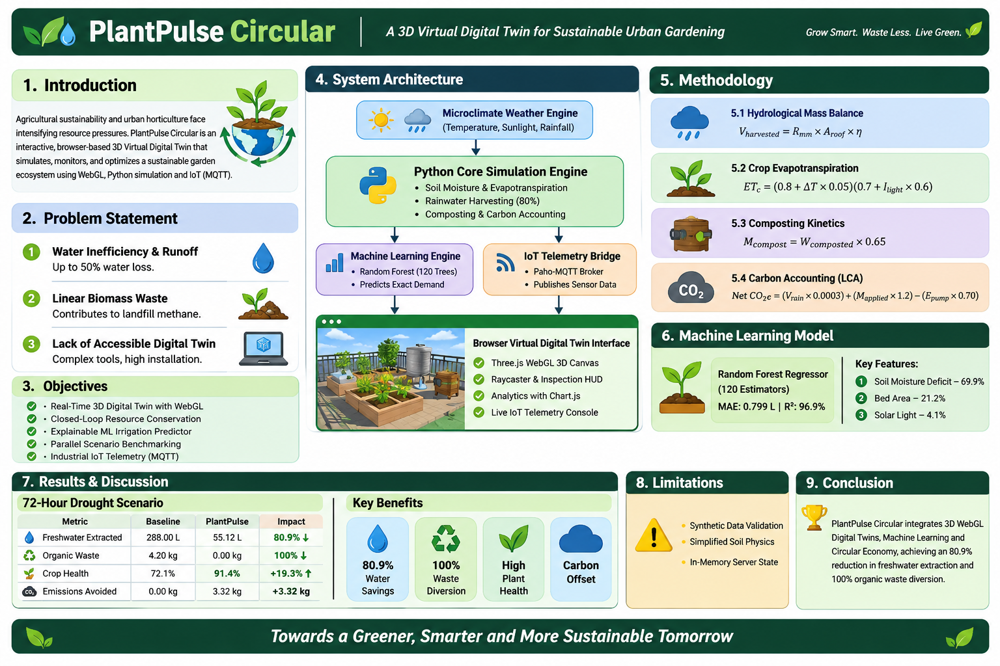
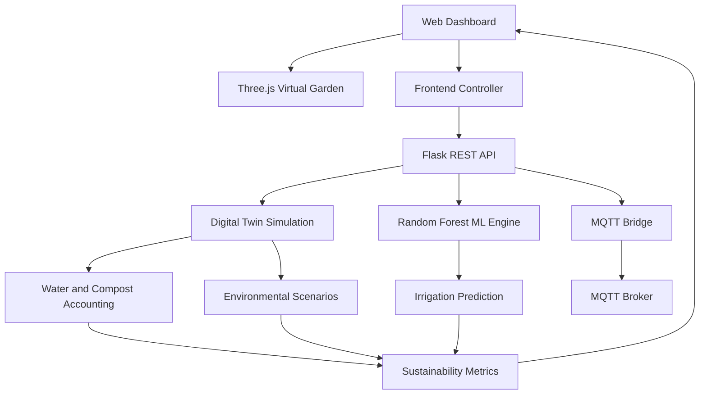

# 🌿 PlantPulse Circular

### The Intelligence Behind a Sustainable Garden.

**A 3D Virtual Digital Twin for Closed-Loop Water, Nutrient & Carbon Management**

<p align="center">
  <a href="https://plantpulse-circular.onrender.com">🌐 Live Demo</a> •
  <a href="https://github.com/prajnanrao/PlantPulse-Circular">💻 Source Code</a>
</p>

<p align="center">
  
  
  
  
  
</p>

---

## The Project at a Glance

PlantPulse Circular transforms a conventional garden-monitoring system into an interactive virtual ecosystem.

It combines a procedural 3D garden, predictive irrigation intelligence, environmental simulation, and circular resource accounting in a single browser-based platform.

**The central idea:** What if a garden could be visualized, monitored, simulated, and optimized through its own digital twin?

## Project Overview

<p align="center">
  
</p>

## What Makes PlantPulse Different?

| Capability | What it does |
|---|---|
| 3D Digital Twin | Visualizes crop beds, rainwater infrastructure, and composting |
| Dynamic Simulation | Models soil moisture, plant stress, weather, and irrigation |
| Predictive Intelligence | Estimates crop-bed irrigation demand using Random Forest |
| Circular Resource Management | Simulates rainwater reuse and organic waste recovery |
| Scenario Comparison | Compares conventional and circular garden operations |
| IoT Communication | Provides MQTT telemetry and remote command integration |

---

## 01 / The Virtual Garden

**A living 3D representation of a circular horticulture ecosystem.**

Powered by Three.js and WebGL, the virtual environment contains three crop beds and two supporting infrastructure units.

- **Roma Tomato Bed:** Climbing vines and developing fruits.
- **Sweet Basil Bed:** Dense aromatic plant clusters.
- **Baby Spinach Bed:** Broad-leaf rosettes.
- **Rainwater Cistern:** Transparent tank with animated water levels, inflow, and pump-status visualization.
- **Compost Bioreactor:** Hexagonal tumbler with animated decomposition steam.

### Interactive Simulation

- Soil appearance changes according to moisture conditions.
- Plant appearance represents simulated water-stress conditions.
- Rainfall and irrigation are visualized through particle effects.
- Users can inspect individual components using raycasting.
- Camera presets provide panoramic, crop-specific, infrastructure, and top-down views.

## 02 / Predictive Intelligence

**Machine learning for smarter irrigation decisions.**

PlantPulse uses a Random Forest Regressor with 120 estimators to predict irrigation demand for individual crop beds.

<details>
<summary><strong>Model performance and evaluation</strong></summary>

| Evaluation Metric | Result |
|---|---:|
| R² Score | 0.969 |
| Mean Absolute Error | 0.799 L |
| Number of Estimators | 120 |
| Training Records | 4,000 |

**Benchmark comparison**

| Approach | MAE |
|---|---:|
| Random Forest | 0.799 L |
| Rule-Based Threshold | 3.273 L |
| Fixed-Timer Baseline | 6.500 L |

**Feature importance**

| Input Feature | Importance |
|---|---:|
| Soil Moisture Deficit | 69.9% |
| Bed Area | 21.2% |
| Light | 4.1% |
| Temperature | 2.5% |
| Crop Type | 1.0% |

</details>

<sub>Model metrics are based on synthetic training data and are not a substitute for real-world field validation.</sub>

## 03 / Circular Economy Simulator

**Compare two different approaches to managing garden resources.**

<details>
<summary><strong>Conventional linear system</strong></summary>

- Tap-water-dependent irrigation.
- Fixed irrigation schedules.
- Organic waste sent to landfill.

</details>

<details>
<summary><strong>PlantPulse circular system</strong></summary>

- Rainwater reuse.
- ML-assisted irrigation demand estimation.
- Organic waste recovery through composting.
- Resource consumption and sustainability accounting.

</details>

### Environmental Stress Scenarios

| Scenario | Conditions |
|---|---|
| Summer Heatwave & Drought | 36–40°C |
| Monsoon Deluge | 8–28 mm rainfall |
| Variable Spring | Changing environmental conditions |

### Reported Simulation Outcomes

<details>
<summary><strong>72-hour drought scenario results</strong></summary>

| Metric | Baseline | PlantPulse |
|---|---:|---:|
| Freshwater Extracted | 288.00 L | 55.12 L |
| Organic Waste | 4.20 kg | 0.00 kg |
| Crop Health | 72.1% | 91.4% |
| Emissions Avoided | 0.00 kg | 3.32 kg |

**Simulated impact:**
- 80.9% reduction in freshwater extraction.
- 100% organic waste diversion.
- 19.3 percentage-point improvement in simulated crop health.

</details>

The scenario engine generates comparative charts and downloadable CSV audit reports.

*These are simulation outputs, not measured experimental results.*

## 04 / Connected IoT Architecture

PlantPulse includes an MQTT communication bridge using Paho-MQTT.

**Telemetry topics**

```text
plantpulse/telemetry/weather
plantpulse/telemetry/beds/{id}
plantpulse/telemetry/tank
plantpulse/telemetry/sustainability
```

**Command topics**

```text
plantpulse/commands/step
plantpulse/commands/mode
```

The bridge supports telemetry publishing, command subscriptions, and a dashboard activity console. Physical sensors and actuators are not connected in the current deployment.

---

## System Architecture



## Technology Stack

| Component | Technologies |
|---|---|
| 3D Engine | Three.js, WebGL |
| Frontend | HTML, CSS, JavaScript |
| Data Visualization | Chart.js |
| Backend | Python, Flask |
| Machine Learning | Scikit-learn, Random Forest |
| Data Processing | NumPy, Pandas |
| Model Storage | Joblib |
| IoT Communication | Paho-MQTT |
| Deployment | Render |
| Testing | Pytest |

---

## Mathematical Model

PlantPulse uses a simulation-based accounting framework for resource and sustainability analysis.

**Freshwater savings**

\[
W_s=\max(0,W_b-W_c)
\]

**Water savings percentage**

\[
W_{\%}=\frac{W_s}{W_b}\times100
\]

**Organic waste recovery**

\[
R_w=\min\left(100,\frac{M_c}{M_e}\times100\right)
\]

**Solar pump energy**

\[
E=V_i\times0.00035
\]

**Avoided carbon emissions**

\[
CO_{2e}=(V_r\times0.0003)+(M_a\times1.2)
\]

Where \(W_b\) is baseline tap-water consumption, \(W_c\) is circular freshwater consumption, \(M_c\) is composted waste, \(M_e\) is eligible organic waste, \(V_i\) is irrigation volume, \(V_r\) is rainwater reused, and \(M_a\) is compost applied.

These equations support comparative accounting within the virtual simulation. They are not independently measured life-cycle assessment results.

---

## Run Locally

### Requirements

- Python 3.10+
- Git
- Modern web browser

**1. Clone the repository**

```bash
git clone https://github.com/prajnanrao/PlantPulse-Circular.git
cd PlantPulse-Circular
```

**2. Create and activate a virtual environment**

```powershell
python -m venv .venv
.venv\Scripts\Activate.ps1
```

**3. Install dependencies**

```bash
python -m pip install -r requirements.txt
```

**4. Train the ML model**

```bash
python -m backend.train_model
```

**5. Launch the application**

```bash
python -m backend.app
```

Open **http://127.0.0.1:5000** in your browser.

## Testing

Run the automated test suite:

```powershell
.venv\Scripts\python -m pytest -v
```

The supplied tests cover API behavior, simulation state transitions, resource accounting, and model evaluation.

---

## Repository Structure

```text
PlantPulse-Circular/
│
├── backend/
│   ├── app.py
│   ├── config.py
│   ├── ml.py
│   ├── mqtt_manager.py
│   ├── simulation.py
│   └── train_model.py
│
├── dashboard/
│   ├── index.html
│   ├── style.css
│   ├── twin3d.js
│   └── app.js
│
├── data/
├── docs/
│   ├── images/
│   │   └── plantpulse-overview.png
│   ├── architecture.md
│   └── methodology.md
│
├── models/
├── tests/
├── unity-twin/
├── requirements.txt
└── README.md
```

## Limitations

- Training and evaluation use synthetic data.
- Soil and crop behavior are simplified simulation models.
- The current application uses an in-memory server state.
- Physical IoT hardware integration is not deployed.
- Carbon and sustainability metrics depend on configured assumptions and emission factors.

## Future Scope

- Integration with physical environmental sensors.
- Real-time hardware-to-digital-twin synchronization.
- Field-calibrated irrigation prediction.
- Persistent historical telemetry and analytics.
- More detailed crop growth and nutrient-cycle modeling.
- Expanded carbon accounting using validated emission factors.

---

## 🌍 Our Vision

PlantPulse Circular explores how digital twins, machine learning, and circular economy principles can work together to make resource management more intelligent.

**Grow Smart. Waste Less. Live Green.**

<p align="center">
  <a href="https://plantpulse-circular.onrender.com"><strong>🌿 EXPLORE THE LIVE DIGITAL TWIN</strong></a>
</p>

<p align="center">
  Built with curiosity, code, and a vision for sustainable technology.
</p>
