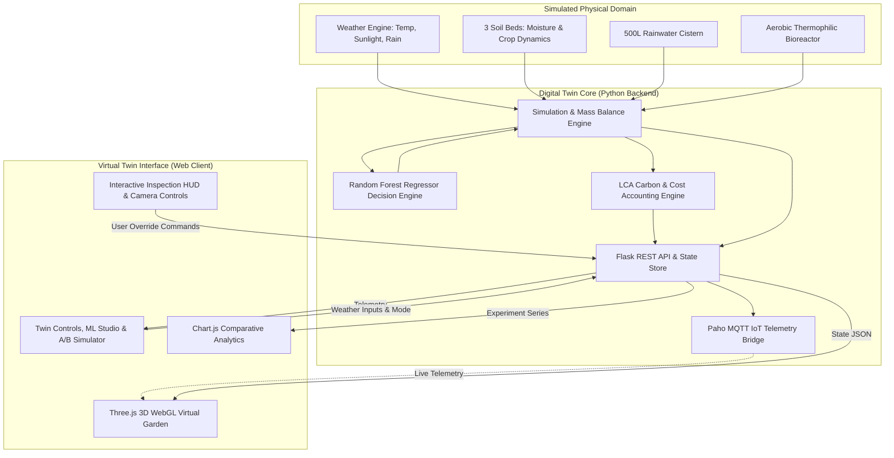

# PlantPulse Circular: Digital Twin System Architecture

## 1. System Overview

PlantPulse Circular is structured around a bidirectional digital twin loop: physical or simulated physical parameters are continuously captured as telemetry, processed through mass/energy conservation models and Machine Learning decision engines, and fed into an interactive 3D virtual environment and automated actuators.



---

## 2. Component Breakdown

### 2.1 Backend Core (`backend/`)
- **`simulation.py`**:
  - Implements multi-bed soil moisture dynamics, taking into account soil area, moisture deficit, ambient temperature, and solar radiation evapotranspiration.
  - Models rainwater collection via roof catchment:
    $$V_{\text{harvested}} = R_{\text{mm}} \times A_{\text{roof}} \times \eta_{\text{capture}}$$
  - Models multi-batch aerobic organic waste composting with thermophilic decomposition phases ($35^\circ\text{C} - 58^\circ\text{C}$).
  - Runs parallel side-by-side scenario simulations comparing conventional linear mode with circular digital twin mode.
- **`ml.py`**:
  - Trains a 120-tree Random Forest Regressor on 4,000 synthetic microclimate observations.
  - Predicts exact water demand per bed with $R^2 = 0.969$ and $\text{MAE} = 0.799\text{ L}$.
  - Computes feature importances across soil moisture, crop area, light index, temperature, and phenology.
- **`mqtt_manager.py`**:
  - Telemetry bridge built with `paho-mqtt` supporting standard MQTT brokers (Mosquitto, EMQX).
  - Publishes telemetry to structured topics and logs messages to an in-memory ring buffer for the web telemetry console.
- **`app.py`**:
  - Flask web server exposing REST endpoints:
    - `GET /` — Serves 3D web digital twin.
    - `GET /api/state` — Full twin snapshot.
    - `POST /api/step` — Advance simulation interval.
    - `POST /api/reset` — Reset twin to initial baseline.
    - `POST /api/mode` — Switch mode (`circular` vs `baseline`).
    - `POST /api/predict` — ML irrigation demand prediction.
    - `GET /api/ml/info` — ML metrics, feature importances, and baseline comparisons.
    - `POST /api/simulate-comparison` — Parallel A/B scenario experiment runner.
    - `GET /api/mqtt/messages` — Real-time telemetry log buffer.

### 2.2 3D Virtual Digital Twin (`dashboard/twin3d.js`)
- Built using **Three.js** with hardware-accelerated WebGL rendering:
  - Procedural 3D Plant Beds (Roma Tomatoes, Sweet Basil, Spinach) with dynamic wilting mechanics.
  - Dynamic soil hydration shader interpolating between dry sandy clay and dark organic loam.
  - Transparent glass rainwater tank with animated internal water mesh and surface ripples.
  - Aerobic compost bioreactor drum with particle steam emitter.
  - Dynamic 3D rain particle system and solar lighting with real-time shadow projection.
  - Precision sprinkler droplet emitters triggered during active irrigation.
  - Raycaster-based interactive inspection HUD with camera interpolation.

---

## 3. MQTT Topic Hierarchy

```
plantpulse/
├── telemetry/
│   ├── weather          # { temperature_c, light_index, rainfall_mm }
│   ├── beds/
│   │   ├── bed-1        # { moisture_pct, health_pct, soil_temp_c, wilting_index, ... }
│   │   ├── bed-2
│   │   └── bed-3
│   ├── tank             # { tank_l, tank_capacity_l, tank_fill_pct, last_action }
│   ├── compost          # { organic_waste_kg, compost_ready_kg, compost_pile_temp_c }
│   ├── sustainability   # { freshwater_saved_l, savings_pct, recovery_pct, ... }
│   └── predictions      # { total_demand_l, by_bed: { ... } }
└── commands/
    ├── step             # { inputs: { temperature_c, rainfall_mm, ... }, irrigation_l }
    ├── mode             # { mode: "circular" | "baseline" }
    └── reset            # Trigger full twin reset
```
